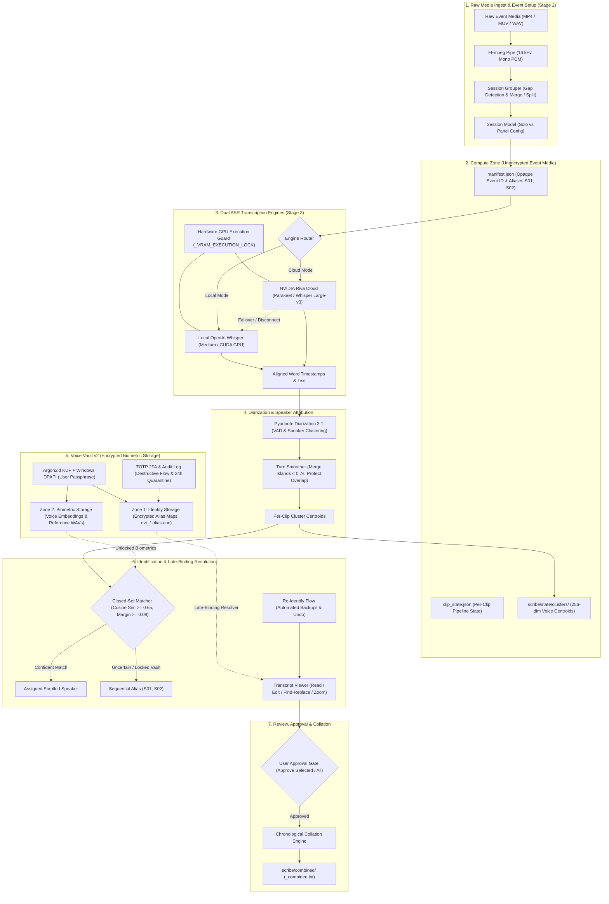
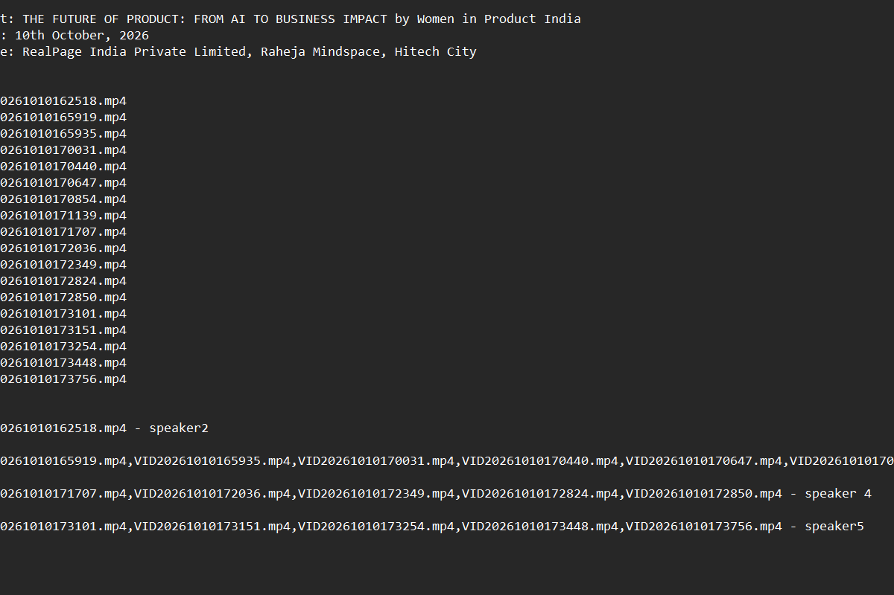
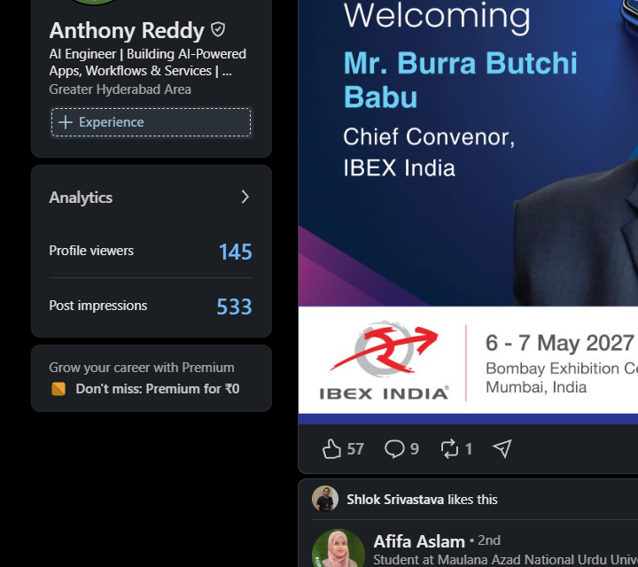

# Session Scribe

Session Scribe is an automated desktop application that turns recorded event videos and audio clips into clean, organized, speaker-identified transcripts. It separates audio from video, identifies speakers using local enrolled voice biometrics, transcribes speech quickly using local hardware or hosted cloud intelligence, and combines approved transcripts per person. You get finished, ready-to-publish text for multi-speaker sessions without manual cutting, renaming, or typing.

---

## 1. Overview and Features

Session Scribe is designed for conference organizers, videographers, and content teams who manage multi-speaker events. The system operates on a privacy-first, local-first architecture: no audio or speaker data is shared or stored externally without explicit user direction, and voice models run locally on consumer GPU hardware.

### Key Capabilities (from the Feature Register)
- **Media Ingest, Session Models & Event Rosters (Stage 2):** Ingests raw event recordings from `data/`, separates 16 kHz mono WAV audio from MP4/MOV videos, detects continuous sessions, and structures event media. Supports **Solo** (single expected speaker) and **Panel** (host plus panelists) session types. Organizers manage an Event Roster selected directly from enrolled Vault v2 profiles (quarantined profiles strictly excluded; names visible only while vault is unlocked). Includes manual **Merge** and **Split** toolbar controls to easily correct automatic time-gap session boundaries.
- **Compute Zone Privacy Isolation & Anonymous Attributions:** Compute-zone files (`manifest.json`, `clip_state.json`) store only sequential event aliases (`S01`, `S02`, ...) and an opaque `event_id` (`evt_<16 hex chars>`). Zero personal names or `spk_` IDs are ever exposed on unencrypted event media disks; authoritative mappings are encrypted in Vault v2 Zone 1 (`alias_maps/<event_id>.alias.enc`). Eliminates dangerous order-of-appearance attribution fallbacks (`roster[idx]`); diarized speech turns without a confident biometric match remain anonymous (`[Unidentified]`).
- **Voice Vault & Biometric Security:** Master keys protected via Windows DPAPI and Argon2id (RFC 9106) key derivation from user passphrases. Encrypts local speaker voice embeddings, reference audio, and identity mappings in isolated Vault v2 (`%LOCALAPPDATA%\SessionScribe\vault\v2\`). Daily unlock requires passphrase only (tied to Windows login); TOTP 2FA protects destructive actions (delete, modify, bulk purge, passphrase change, TOTP reset with 24h wait). Features two-zone envelope encryption, late-binding name resolution, strict egress guards, hash-chained audit logging with head mirror outside vault, 24-hour quarantine (quarantined profiles strictly excluded from matching and name resolution), and crypto-shredding (see [docs/security/threat_model.md](docs/security/threat_model.md) and [docs/security/vault_format.md](docs/security/vault_format.md)). Note: TOTP is an access-control layer (wrapped under master key), not an offline factor; crypto-shredding is final only if no earlier copy of the vault exists (backups, shadow copies, restore points); future FIDO2 hmac-secret option is planned. Runs cannot lock mid-flight and include progressive brute-force delays.
- **Voice Profile Enrollment Engine & Quality Calibration (Phase V4):** Import voice reference samples from audio or video media with optional time ranges into memory via FFmpeg pipes (zero unencrypted audio touches disk). Features Pyannote neural diarization (`pyannote/speaker-diarization-3.1`), voice-activity detection (VAD), and overlapped-speech duration measurement alongside custom SNR ($\ge 12.0$ dB), loudness (RMS), and digital clipping analysis. Classified into 3-tier verdicts: `CLEAR_PASS` ($\ge 15.0$s speech, single speaker, $\le 0.3$s overlap), `BORDERLINE` (10–15s speech, 0.3–1.5s overlap, SNR 9–12 dB, requiring explicit "Accept Anyway" override logged to the Keyed-MAC audit trail), and `CLEAR_FAIL` (unconditional rejection). Includes standalone calibration CLI (`scripts/voice_quality_report.py`), cross-sample consistency tracking ($< 0.65$ cosine similarity flags inconsistency), and duplicate profile detection ($\ge 0.82$ cosine similarity against existing Zone 2 profiles). Enrolls 3 to 5 samples per person into Vault v2 (Zone 1 Identity + Zone 2 Biometric) with explicit consent records (`consent_noted=True`, `consent_date_utc`), model versioning (`model_version: "1.0.0"`), re-embedding path (`re_embed_all_profiles()`), and hardware-isolated VRAM execution (`_VRAM_EXECUTION_LOCK`). Access is strictly guarded in the UI by confirmed vault unlock state.
- **Speaker Identification Engine & Optional Vault Decoupling (Phase V6):**
  - **Decoupled Workflow & Optional Vault:** The entire application (Stage 2 media separation, Stage 3 transcription, Approval gate, and Collation) operates seamlessly whether Voice Vault is locked, unlocked, or never created. Vault setup prompts can be skipped with a remembered preference ("Skip for now" on chip / setup dialog). Transcriptions proceed with sequential speaker aliases (`S01`, `S02`) or generic labels (`Speaker 1`, `Speaker 2`). Decrypted names are late-bound only when viewing transcripts while unlocked and exporting combined files (`<Speaker>_combined.txt`).
  - **Hardware & Voice Data Isolation:** The ASR step receives zero speaker biometrics or identity information. Whisper and Pyannote strictly alternate GPU access under `_VRAM_EXECUTION_LOCK`, guaranteeing they never contend for GPU memory concurrently.
  - **Closed-Set Session Roster Matching:** Evaluates speech clusters strictly against the session roster (Host evaluated first in panels), accepting matches above provisional threshold ($\ge 0.65$) with margin ($\ge 0.08$) over second-best.
  - **Acoustic Centroid Linking:** Cross-clip cluster linking is voice-only based on acoustic centroid cosine similarity ($\ge 0.70$), never order or gap. Short turns ($< 2.5$s) receive low confidence; unmatched short turns in panel sessions become `[Audience]`.
  - **In-Place Re-Identify & "Who is this?" Flow:** "Re-Identify…" button in Stage 3 re-runs attribution matching across existing transcripts with zero re-transcription. The "Who is this?" prompt (`ReidentifyDialog`) allows listening to representative in-memory speech snippets, assigning roster members, or enrolling new profiles into Vault v2. Includes automated timestamped transcript backups (`scribe/state/reidentify_backups/`) prior to rewriting and an "Undo Re-Identify" button to immediately revert reassignments.
  - **Dialogue Isolation & Combined Deduplication:** Name-to-alias mapping in viewers, Re-Identify, and combined files strictly targets line-start tags (`[Speaker] [HH:MM:SS - HH:MM:SS]`) and headers, guaranteeing spoken dialogue is never modified. When rebuilding combined files, stale alternate combined files (e.g. `S01_combined.txt`) are automatically archived to `scribe/combined/old/` to avoid duplicates.
  - **Persistent Voice Clusters & Centroids:** When Stage 3 diarizes a clip, anonymous speaker segments, cluster centroids (256-dimensional unit vectors), and representative snippet time ranges (no audio, no personal names) are saved to `<event root>\scribe\state\clusters\<clip>.json`. *(Note: this file contains voice centroids).* Re-Identify loads this data across restarts, allowing automatic acoustic matching to work seamlessly whenever the vault is unlocked later. For older events transcribed prior to this feature, Re-Identify maintains a label-based fallback and notifies the user in the review dialog that automatic acoustic matching is unavailable.
- **Dual Transcription Engines:**
  - **Local Whisper:** Runs OpenAI Whisper (Medium) directly on NVIDIA laptop/desktop GPUs via PyTorch and CUDA. Completely offline, zero bandwidth required.
  - **Cloud Riva:** Ephemeral streaming transcription via NVIDIA Riva gRPC (Parakeet and Whisper), achieving 10× to 15× real-time decoding with automatic local failover.
- **Live Timers & Engine Display (Stage 3):** Real-time ticking `hh:mm:ss` timers per running clip and pinned totals row. Displays dynamic status (`● Transcribing 42%`, `● Diarizing`, `● Identifying`), live engine handovers (`Parakeet → Whisper medium`), failover timers, and ETA estimates without layout jitter.
- **Midpoint Checkpoint Resume:** Lightweight session state tracking (`session_state.json`) with 30-second window checkpoints and ffmpeg `-ss` fast input seeking. Network drops or cancellations resume from the last saved boundary without re-transcribing completed segments.
- **In-App Viewer & Protected Find/Replace:** Dual Read/Edit modes, atomic disk writes, original backups, and interactive Find & Replace (Ctrl+F / Ctrl+H) with protected speaker headers, timestamps, and single-step undo.
- **Multi-Level Zoom Support:** Zoom transcripts from 50% to 300% via toolbar controls, Ctrl+Wheel, or touchpad pinch gestures while preserving the active reading anchor.
- **User Approval Gate & Chronological Collation:** Explicit multi-select user approvals ("Approve Selected", "Approve All Completed"). Once approved, outputs are collated chronologically into single documents per speaker under `scribe\combined\<Speaker>.txt`.
- **Atomic Speaker Rename:** Rename speakers across manifests, clip states, and transcripts in one step without invalidating transcription caches or re-running audio decoding.
- **Excel-Resilient Usage Logging:** Writes attempt-level and run-level telemetry to `attempts.csv` and `runs.csv` in UTF-8 with BOM (`utf-8-sig`). Includes a background `.pending/` spooling queue so logging never blocks if the CSV is locked in Microsoft Excel.
- **Accessible Design System:** Light and dark high-contrast themes conforming to WCAG AA (>= 4.5:1 contrast ratios), DPI scaling, adaptive column resizing with zero horizontal scrollbars, and proportional drag redistribution.
- **Model Registry & Multi-Run Comparison:** Evaluate local Whisper models (tiny, base, small, medium) and cloud engines (NVIDIA Parakeet, Whisper Large-v3) with VRAM guards and rate-limit warnings. Re-transcribe in **Compare Mode** to evaluate models side-by-side with Word Error Rate (WER) and speedup metrics in a bottom drawer, promote preferred runs to primary, and export multi-sheet Excel reports (`.xlsx` with zero external dependencies) and companion UTF-8 BOM CSVs.
- **Card-Based Re-transcribe Dialog & Sticky Controls:** Modal interface (~720x640, resizable) featuring selected clip file size and duration cards, segmented Compare vs Replace execution modes, rich selectable model cards with custom vector hardware/cloud icons and VRAM/speed/cost chips, and an anchored sticky footer with real-time estimates, warning bar, live percentage progress, and a spinning elapsed timer (`⏳ Transcribing… hh:mm:ss`).
- **Universal Smooth Touchpad & Drag Scrolling:** Native-feel scrolling across all tabs, dialogs, drawers, and transcript viewers. Features high-precision sub-notch touchpad delta accumulation (floating-point deltas with no deadzones or jumpiness), horizontal Shift+wheel routing, standard desktop keyboard navigation (`PgUp`/`PgDn`/`Home`/`End`/Arrows), and intuitive mouse/touch drag-to-scroll gesture panning with a 6px deadzone.
- **Theme System v2 & Modern Inputs:** Elevated dark input surfaces (`#2E2E32`) with distinct focus borders (`#0078D4`), high-contrast placeholders ($\ge 5.2:1$), monospace code cards for resolved paths and speaker mapping, semibold typography hierarchy, and verified WCAG AA compliance across all surfaces.

---

## 2. System Architecture

Session Scribe separates audio/video processing, privacy-isolated compute state, cryptographic biometric storage, and dual ASR transcription engines into distinct isolated layers:



See [docs/architecture.md](docs/architecture.md) for detailed subsystem breakdowns and cryptographic boundaries.

---

## 3. Screenshots (Sample Data Only)

> *Note: All screenshots illustrate Session Scribe operating with simulated sample data. No real personal names, voice data, or event materials are depicted.*

| Stage 2 Dark Mode Form & Mappings | Stage 2 Light Mode Form |
| :---: | :---: |
| <br>*Sample data: Elevated dark inputs, monospace paths banner, and speaker mappings.* | <br>*Sample data: Stage 2 light mode form and metadata configuration.* |

| Stage 3 Dark Mode Overview | Re-Transcribe Dialog (Dark) |
| :---: | :---: |
| <br>*Sample data: Stage 3 clip table with live status and engine telemetry.* | <br>*Sample data: Model selection and execution mode (Replace vs Compare).* |

---

## 4. Technology Stack

Session Scribe is built entirely in Python, utilizing standard system libraries, robust local machine learning frameworks, and an isolated desktop GUI.

- **Primary Desktop Interface:** Python Tkinter / ttk with custom Clam-derived professional styling (`gui/app.py`). Provides rock-solid stability and zero external GUI dependencies.
- **Next-Generation Desktop Interface (Prototype):** PySide6 (Qt for Python) top-tab application (`gui/qt/main_window.py` on branch `ui-qt-migration`). Features native Windows 11 Fluent styling, WCAG AA dual themes, and adaptive column math.
- **Local Speech Recognition:** `openai-whisper==20250625` (Medium model) running locally on CUDA-accelerated hardware.
- **Speaker Diarization & Voice Embeddings:** `pyannote.audio==3.1.1` and `torch==2.4.1+cu121`.
- **Cloud Speech Services:** NVIDIA Cloud Riva API via `grpcio==1.76.0` and protobuf protocols.
- **Audio I/O & Signal Processing:** `soundfile==0.14.0`, `numpy==1.26.4`, and system `ffmpeg`.
- **Security & Key Derivation:** Standard library `hashlib.blake2b` for RFC 9106 Argon2id key derivation and Windows DPAPI (`CryptProtectData` / `CryptUnprotectData` via `ctypes.windll.crypt32`).

---

## 5. Installation & Environment Setup

Follow these exact steps to configure your Python environment and hardware dependencies.

### 1. Prerequisites
- **Operating System:** Windows 10 or Windows 11 (64-bit).
- **Python:** Python 3.11.9 (64-bit).  
  *Recommended executable path:*  
  `C:\Users\antho\AppData\Local\Programs\Python\Python311\python.exe`
- **FFmpeg:** Must be installed and available on your Windows system PATH.  
  Verify in PowerShell: `ffmpeg -version`.  
  *(Install if needed via `winget install Gyan.FFmpeg`).*
- **Tesseract OCR (Optional):** Required if extracting title slides from video frames.  
  Verify in PowerShell: `tesseract --version`.

### 2. Create the Pinned Virtual Environment
Open PowerShell in the repository root (`D:\Session_Scribe`) and create the virtual environment:
```powershell
C:\Users\antho\AppData\Local\Programs\Python\Python311\python.exe -m venv D:\Session_Scribe\.venv
```

### 3. Install CUDA PyTorch First
Always install PyTorch with CUDA 12.1 support before installing other requirements to ensure GPU acceleration is linked properly:
```powershell
D:\Session_Scribe\.venv\Scripts\python.exe -m pip install --upgrade pip
D:\Session_Scribe\.venv\Scripts\python.exe -m pip install torch==2.4.1+cu121 torchaudio==2.4.1+cu121 --extra-index-url https://download.pytorch.org/whl/cu121
```

### 4. Install Project Requirements
Install the locked dependency set:
```powershell
D:\Session_Scribe\.venv\Scripts\python.exe -m pip install -r requirements-lock.txt
```

### 5. Run the Preflight Check
Verify that all system components, CUDA drivers, ffmpeg binaries, and write permissions are operational:
```powershell
D:\Session_Scribe\.venv\Scripts\python.exe scripts/preflight_check.py
```

---

## 6. Usage Guide

### Starting the Application

#### Option 1: Start Menu Shortcut (Recommended)
You can install Session Scribe into your Windows Start Menu without administrator rights:
```powershell
& .\scripts\install_start_menu.ps1
```
- **Launch without console window:** The shortcut runs `.venv\Scripts\pythonw.exe -m gui.app` with working directory set to `D:\Session_Scribe`, suppressing any terminal console window.
- **Icons & Taskbar Identity:** The shortcut, window, and taskbar use `assets\icons\session_scribe.ico` (which bundles 16, 24, 32, 48, 64, 128, and 256 px resolutions). Session Scribe sets an explicit `AppUserModelID = "SessionScribe.TranscriptionApp.2026"` so Windows taskbar groups and shows the custom icon properly rather than a generic Python icon.
- **How to Pin to Taskbar Manually:**
  1. Open the Windows Start menu.
  2. Search for **Session Scribe** (or browse to it in **All apps**).
  3. Right-click **Session Scribe** and select **Pin to taskbar** (or **Pin to Start**).
- **Single-Instance Enforcement:** If you launch Session Scribe a second time while it is already running, the second launch automatically restores and brings the existing window to the front and terminates cleanly without spawning duplicate instances.
- **Startup Diagnostics & Log Rotation:** Because `pythonw.exe` runs silently without a console, any fatal startup failures display a clear graphical error dialog directing you to the diagnostic log file. Rotated logs are saved to `%LOCALAPPDATA%\SessionScribe\logs\session_scribe.log` (2MB per file, 5 rotated backups, with automatic secret scrubbing).
- **About Dialog:** Accessible via the **About** button in the header bar or through **Help ▾ → About Session Scribe** on the window menu bar. Displays application name, version, author **Anthony Reddy**, copyright notice `© 2026 Anthony Reddy. All rights reserved.`, and the logo in high-contrast theme tokens.
- **Icon Cache Refresh:** If Windows displays a generic or blank icon due to cached icon entries, rebuild the icon cache with:
  ```powershell
  ie4uinit.exe -show
  ```
- **How to Uninstall the Shortcut:**
  ```powershell
  & .\scripts\uninstall_start_menu.ps1
  ```
  Both installer and uninstaller scripts are idempotent and safe to run repeatedly.

#### Option 2: Command Line Launch
To launch the desktop application directly from PowerShell:
```powershell
D:\Session_Scribe\.venv\Scripts\python.exe -m gui.app
```
*(To preview the PySide6 Qt migration interface: `D:\Session_Scribe\.venv\Scripts\python.exe -m gui.qt.main_window`).*

### Step-by-Step Workflow
1. **Prepare Raw Media:**  
   Create an event folder under `D:\Events\<Event-Name>\data\` and copy your raw camera videos (`.mp4`, `.mov`) or audio recordings (`.wav`) into it.
2. **Unlock Voice Vault:**  
   If enrolling speakers or writing sensitive identity data, click the **🔒 Vault** chip in the header bar and unlock it with your passphrase.
3. **Stage 2: Ingest & Session Assignment:**  
   - Select the event directory via the **Browse** button.
   - Click **Dry Run** to verify incoming clips, then click **Move Files** to sort media into `Videos/` and extract 16 kHz WAV audio into `Audio/`.
   - Paste speaker names into the speaker mapping text area (one person per line).
   - Click **Detect Sessions & Assign Photos**, review the session breakdown, and click **Save Manifest**.
4. **Stage 3: Transcription Execution:**  
   - Switch to the **Stage 3** tab.
   - Choose your engine: **Cloud Riva** (hosted NVIDIA Parakeet / Whisper) or **Local Whisper** (laptop GPU).
   - Click **Run Test Clips** to process the 2 test clips. Review their transcripts in the bottom panel and click **Approve Test Clips**.
   - Click **Transcribe All** to process the remaining clips. Live timers, failover tracking, and progress percentages update smoothly in the table.
5. **Review & Approval:**  
   - Double-click any clip row to open the interactive transcript editor.
   - Use **Find** (Ctrl+F) or **Replace** (Ctrl+H) to correct spelling or terminology. Click **Save** (Ctrl+S) when satisfied.
   - Click **Approve Selected** or **Approve All Completed** to mark transcripts ready for collation.
6. **Combine Transcripts:**  
   - Click **Combine Approved Transcripts**. Chronological text documents per speaker are created under `scribe\combined\<Speaker>.txt`.
7. **Inspect Usage & Diagnostics:**  
   - Check `scribe\usage\attempts.csv` and `runs.csv` for detailed attempt histories, failover durations, and speed factors.

---

### Voice Vault Guide: Exact Clicks & UI Navigation

The Voice Vault isolates biometric speaker embeddings and personal identities behind Argon2id + DPAPI encryption. The app functions completely without it (using generic aliases `S01`, `S02`), but unlocking the vault unlocks real-time speaker identification, late-bound name resolution, and decrypted file collation.

#### Dialog Entry Points Across the App
- **Header Menu (`Vault ▾`) / Top Menubar (`Vault`):**
  - **Lock / Unlock Vault...** -> Opens `UnlockVaultDialog` (or locks if currently unlocked).
  - **Enroll Voice Profile...** -> Opens `VoiceProfileEnrollmentDialog`.
  - **Event Speaker Roster...** -> Opens `EventRosterDialog`.
  - **Quarantined Profiles (24h Hold)...** -> Opens `QuarantineManagerDialog`.
  - **Change Passphrase...** -> Opens `ChangePassphraseDialog`.
  - **Forgot Passphrase / Erase Vault...** -> Opens `ForgotPassphraseDialog`.
- **Status Chip (`🔒 Vault: Locked (Xd)` / `🔓 Vault: Unlocked (Xd)`):**
  - **Left-Click:** Opens `UnlockVaultDialog` (when locked) or locks immediately (when unlocked). Tooltip shows exact passphrase age and security status.
  - **Right-Click:** Context menu with direct shortcuts to Lock/Unlock, Change Passphrase, Quarantined Profiles, and Reset/Erase Vault.
- **Stage 2 Tab:**
  - **Event Speaker Roster...** button in the session toolbar opens `EventRosterDialog`.
  - **Session Type** dropdown in each session card toggles **Solo (Single Speaker)** vs **Panel (Multi-Speaker)**.
- **Stage 3 Tab Review Bar:**
  - **Re-Identify Speakers...** button opens `ReIdentifyDialog`.
  - **Undo Re-Identify** button restores previous transcript versions from automated backups.
- **Event Roster Dialog:**
  - **Quarantine Profile...** button opens `DestructiveConfirmationDialog` for a 24-hour quarantine hold.
  - **Quarantine Manager...** button opens `QuarantineManagerDialog`.
- **Unlock Vault Dialog:**
  - Blue action link **Forgot passphrase?** at the bottom opens `ForgotPassphraseDialog`.

#### Exact Click Flows

1. **Create the Vault (Initial Setup):**
   - Click the header chip `🔒 Vault: Not Initialized` (or select `Vault ▾` -> `Lock / Unlock Vault...`).
   - In the setup dialog, enter a passphrase ($\ge 14$ characters or 5–6 random words; click 🎲 to auto-generate a secure Diceware phrase).
   - *(Optional)* Toggle **Enable Authenticator (TOTP)** and scan the QR code with Google Authenticator or 1Password, or click **Show Secret Key** to write it down offline.
   - Click **Initialize Vault**. The vault is initialized and immediately unlocked.

2. **Unlock and Lock:**
   - **To Unlock:** Click `🔒 Vault: Locked` (or select `Vault ▾` -> `Lock / Unlock Vault...`). Enter your master passphrase and click **Unlock Vault**. (Daily unlock requires passphrase only; TOTP is never asked for daily unlock). If the passphrase is $\ge 365$ days old, a non-blocking reminder dialog offers "Change now" or "Remind me in 7 days".
   - **To Lock:** Click `🔓 Vault: Unlocked` (or select `Vault ▾` -> `Lock / Unlock Vault...`). Locks instantly. (Also auto-locks after 30 minutes of inactivity or upon Windows Win+L workstation lock).

3. **Enrol a Voice Profile:**
   - Ensure the vault is unlocked.
   - Select `Vault ▾` -> `Enroll Voice Profile...`.
   - Enter Full Name, Affiliation, and primary Role. Check `[x] Consent granted for voice matching`.
   - Click **Add Audio/Video Sample...** and choose a video (`.mp4`, `.mov`) or audio (`.wav`) file. Session Scribe streams audio into RAM via FFmpeg without saving unencrypted audio to disk.
   - Pyannote analyzes VAD, diarization, and overlap, displaying speech duration, SNR, loudness (RMS), and digital clipping.
   - Review the verdict: `CLEAR_PASS` waits for your explicit **Accept Sample** click; `BORDERLINE` shows the exact numbers and allows **Accept Anyway** with explicit confirmation logged to the audit trail.
   - Add 3 to 5 samples, review cross-sample consistency, and click **Enroll Profile**.

4. **Open Event Roster:**
   - In Stage 2, click the **Event Speaker Roster...** button in the session toolbar (or select `Vault ▾` -> `Event Speaker Roster...`).
   - If unlocked, all enrolled speakers (excluding quarantined profiles) appear with checkboxes. Check the attendees for this event.
   - Customize their sequential aliases (`S01`, `S02`) if desired and click **Save Roster**.

5. **Set a Session to Panel or Solo:**
   - In Stage 2, browse the session cards in the lower panel.
   - For a keynote or single talk: Select **Solo (Single Speaker)** from the **Session Type** dropdown and choose the expected speaker from the roster.
   - For a multi-speaker debate or fireside chat: Select **Panel (Multi-Speaker)**. Hosts and Panelists are assigned automatically from the event roster.
   - Click **Save Manifest** in the toolbar.

6. **Re-Identify and Undo:**
   - In Stage 3, click **Re-Identify Speakers...** in the review bar.
   - The engine loads voice centroids from `scribe\state\clusters\<clip>.json` (persisted during Stage 3 diarization) and matches them against enrolled Vault v2 profiles—no re-transcription required.
   - Review proposed speaker replacements and click **Apply Re-Identification**.
   - Before modifying transcripts, the app automatically archives existing transcript versions to `scribe\state\history\reidentify_backup_<timestamp>\`.
   - To revert: Click **Undo Re-Identify** in the review bar to immediately restore previous versions.

7. **Quarantine Manager and Delete Flow:**
   - Select `Vault ▾` -> `Quarantined Profiles (24h Hold)...` (or click "Quarantine Manager..." inside Event Roster).
   - **To Quarantine:** Select a speaker, click **Quarantine Profile...**, enter your TOTP code, and confirm. The profile enters a mandatory 24-hour quarantine hold and is immediately excluded from matching, rosters, and name resolution.
   - **To Restore:** Inside Quarantine Manager, select the profile and click **Restore Profile**.
   - **To Permanently Delete:** After 24 hours have elapsed, select the profile and click **Permanently Purge Profile**. Enter your master passphrase and TOTP code to cryptographically shred biometric embeddings and identity records.

8. **Change Passphrase:**
   - Select `Vault ▾` -> `Change Passphrase...` (or right-click the Vault chip -> `Change Passphrase...`).
   - Enter your current passphrase, followed by your new passphrase (or click 🎲 for a random phrase).
   - If TOTP is enabled, enter your 6-digit authenticator code.
   - Click **Update Passphrase**. The master key is securely re-wrapped, and the 365-day age timer resets to 0.
   - > [!WARNING]
   - > **Security Warning:** Change the passphrase immediately if you think it was exposed.

9. **"Forgot Passphrase?" Permanent Erase Flow:**
   - Open the Unlock dialog via the Vault chip or `Vault ▾` -> `Lock / Unlock Vault...`.
   - Click the blue link **Forgot passphrase?**.
   - The dialog explains that there is no recovery mechanism and that continuing will permanently erase all enrolled voices, event alias links, and authenticator secrets, while event data (`transcripts/`, `manifest.json`, audio files) remains untouched.
   - Type `ERASE VAULT` into the confirmation field and click **Permanently Erase Vault**.
   - All vault files are shredded, throttle and TOTP state are wiped, a `VAULT_PERMANENTLY_ERASED` event is appended to the audit log, and the app transitions immediately to the initial Setup dialog.

### Per-Event Folder Map
Session Scribe enforces a strict, predictable directory structure inside each event folder:

```text
D:\Events\<event_name>\
├── data/                               <- Raw incoming camera recordings & media
└── scribe/
    ├── Audio/                          <- Extracted 16 kHz mono WAV audio files
    ├── Videos/                         <- Organized source video recordings
    ├── manifest.json                   <- Central event blueprint and session map
    ├── transcripts/                    <- Completed individual clip transcripts (.txt)
    ├── combined/                       <- Chronologically merged transcripts per speaker
    ├── reports/                        <- Analytical run summaries and error reports
    ├── usage/
    │   ├── runs.csv                    <- Batch run summaries (Excel utf-8-sig)
    │   ├── attempts.csv                <- Detailed attempt history per clip
    │   └── .pending/                   <- Spool queue when CSV is locked in Excel
    └── state/
        ├── clip_state.json             <- Clip completion & user approval registry
        ├── session_state.json          <- Midpoint checkpoint resume timestamps
        ├── clusters/                   <- Voice centroids (segment timings & centroid vectors; no raw audio)
        └── history/                    <- Archived previous versions of edited transcripts
```

> [!NOTE]
> **Voice Centroid Privacy:** `scribe\state\clusters\<clip>.json` stores per-clip speaker segment timings, 256-dimensional neural cluster centroid vectors, and short representative snippet offsets (not raw audio). It contains no personal names or identity metadata. This allows the Re-Identify tool to match diarized speech against newly enrolled or unlocked profiles across app restarts without re-transcribing audio.

**Global User Folders (Outside Repository):**
- `D:\Events\_voice_library\`: Local voice enrollment profiles for speaker recognition (strictly local, never committed).
- `D:\Events\_usage\account_attempts.csv`: Account-wide log of cloud transcription requests.

### Keyboard Shortcuts

| Shortcut | Action | Scope |
| :--- | :--- | :--- |
| **Ctrl + F** | Open interactive Find bar | Transcript Viewer / Editor |
| **Ctrl + H** | Open Find & Replace bar with protected headers | Transcript Viewer / Editor |
| **Ctrl + S** | Save transcript changes atomically | Transcript Editor |
| **Ctrl + Z** | Single-step undo for replacement | Transcript Editor |
| **Ctrl + MouseWheel** | Scale text zoom from 50% to 300% | Transcript Viewer / Editor |
| **Ctrl + Backspace** | Delete previous word | All text inputs & search bars |
| **Ctrl + Left / Right** | Word-by-word caret navigation | All text inputs & search bars |
| **Ctrl + A** | Select entire text | All text inputs & search bars |

---

## 7. Architecture & Codebase Map

The Session Scribe repository is organized cleanly by functional boundary:

```text
D:\Session_Scribe\
├── gui/                                <- Tkinter / ttk production application
│   ├── app.py                          <- Main application shell and top navigation
│   ├── stage2_tab.py                   <- Stage 2 media ingest & session grouping
│   ├── stage3_tab.py                   <- Stage 3 transcription, live table & editor
│   ├── placeholder_tabs.py             <- Placeholder views for Stage 4 and Stage 5
│   ├── event_context.py                <- Inter-tab shared state and event bindings
│   ├── theme.py                        <- Central design system tokens and ttk styles
│   ├── vault_dialog.py                 <- Voice vault unlock/init dialogs & header chip
│   ├── zoom_helper.py                  <- Text zoom engine with anchor preservation
│   └── qt/                             <- PySide6 Qt migration prototype
│       ├── main_window.py              <- Qt main window shell with top tab bar
│       ├── stage2_view.py              <- Qt Stage 2 view with adaptive tables
│       ├── stage3_view.py              <- Qt Stage 3 view with history drawer
│       ├── usage_view.py               <- Qt Usage & telemetry dashboard
│       └── design_system/              <- Qt Fluent design tokens and controls
├── scribe_core/                        <- Headless business logic and pipelines
│   ├── voice_vault.py                  <- DPAPI + Argon2id voice encryption vault
│   ├── voice_library.py                <- Speaker enrollment and voice verification
│   ├── clip_state.py                   <- clip_state.json manager & approval logic
│   ├── session_tracker.py              <- 30s checkpoint resume tracker
│   ├── cloud_engine.py                 <- NVIDIA Riva gRPC client & failover logic
│   ├── event_paths.py                  <- Per-event path resolver and validator
│   ├── usage_csv.py                    <- Excel-resilient CSV logger & spooler
│   ├── combined_transcripts.py         <- Chronological per-speaker transcript collator
│   └── transcription_manager.py        <- Background subprocess orchestration
├── tests/                              <- Automated test suites (isolated tempfile I/O)
│   ├── test_voice_vault.py             <- Argon2id, DPAPI & auto-lock tests
│   ├── test_stage3_live_timers.py      <- Live ticking clock & zero-jitter tests
│   ├── test_stage3_tk_table.py         <- Adaptive column math & drag tests
│   ├── test_voice_library.py           <- Speaker voice embedding & role tests
│   ├── test_design_system_v2.py        <- Design system typography & contrast tests
│   ├── test_theme_contrast.py          <- WCAG AA contrast verification tests
│   └── test_qt_prototype.py            <- PySide6 feasibility and prototype tests
├── scripts/                            <- Maintenance, preflight, and utility scripts
│   ├── preflight_check.py              <- Environment and GPU sanity check
│   └── secret_scan.py                  <- Automated zero-credential leak scanner
├── docs/                               <- Documentation and dummy assets
│   └── images/                         <- User documentation screenshots (sample data)
├── records/                            <- Work records and register indices (markdown only)
│   ├── registers/                      <- FEATURES.md, BUGS.md, IDEAS.md, README.md
│   └── YYYY-MM-DD/                     <- Dated work records with daily INDEX.md
├── requirements-lock.txt               <- Pinned dependency lockfile
├── .env.example                        <- Sanitized environment variable template
├── CHANGELOG.md                        <- Chronological change log
├── AGENTS.md                           <- Contributor rules and repository standards
└── README.md                           <- User guide and repository overview
```

---

## 8. Environment Variables (.env File)

Session Scribe supports optional hosted cloud APIs and speaker diarization models via environment variables. Create a `.env` file in the project root (`D:\Session_Scribe\.env`):

```ini
# Optional: NVIDIA Hosted Riva Cloud Speech API Key
NVIDIA_API_KEY=nvapi-your-key-here

# Optional: Hugging Face User Access Token
HF_TOKEN=hf_your-token-here
```

A template file (`.env.example`) is provided in the repository root.

> **Security Rule:** Never commit, share, or store `.env` in version control. The `.env` file is permanently ignored in `.gitignore`. Session Scribe automatically redacts all keys, tokens, and passphrases from application logs, error dialogs, CSV outputs, and bug reports.

---

## 9. Contribution Guidelines

All contributors and AI agents working on Session Scribe must strictly adhere to the guidelines set out in [AGENTS.md](AGENTS.md):

1. **Where Files Belong:**
   - App logic: `gui/` or `scribe_core/`.
   - Automated tests: `tests/`.
   - Maintenance scripts: `scripts/`.
   - Work records: Dated folders under `records/YYYY-MM-DD/` (**markdown only**).
   - Registers: `records/registers/` (**markdown only**).
   - No loose files directly inside `records/`.
2. **Work Records & Changelog:**
   - Every modification requires a work record in that day's dated folder (`records/YYYY-MM-DD/<type>_<short-title>.md`).
   - Maintain the daily `INDEX.md`, the registers in `records/registers/`, and `CHANGELOG.md` in the project root.
3. **Test Isolation:**
   - Tests must never touch real user events or the user's `D:\Events\` directory.
   - All tests use `tempfile.mkdtemp()` and derive paths dynamically.
4. **Commits:**
   - Do not commit changes unless explicitly instructed by the user.
5. **Credential Safety:**
   - Never print, log, or store secrets, tokens, passphrases, or voice identity data. Always run `python scripts/secret_scan.py` before completing work.

---

## 10. License and Author

- **Author & Copyright:** Anthony Reddy © 2026
- **License:** All rights reserved © 2026 Anthony Reddy. See [LICENSE](file:///d:/Session_Scribe/LICENSE).

---

## 11. Troubleshooting and Cloud Failover Classes

When Cloud transcription encounters an issue, it never fails silently. The application shows a toast notification, updates the Engine column tooltip, displays a persistent banner, and logs a structured `failover_reason` in `attempts.csv` matching one of the 12 standardized diagnostic classes:

| Failover Class | Nature | Probable Cause | Action / Handover Behavior |
| :--- | :--- | :--- | :--- |
| **`auth`** | Configuration | Invalid, expired, or unauthorized `NVIDIA_API_KEY`. | Fails back immediately (`retries=0`). Verify API key in `.env`. Cloud disabled for rest of run. |
| **`key_not_found`** | Configuration | No NVIDIA API key detected in environment or `.env`. | Fails back immediately (`retries=0`). Add key via Stage 3 Connections or `.env`. |
| **`function_not_found`** | Configuration | Cloud function ID is retired or missing from NVCF catalog. | Fails back immediately (`retries=0`). Check NVCF catalog via "Check Models". |
| **`invalid_argument`** | Configuration | Unsupported language code, sample rate, or audio encoding. | Fails back immediately (`retries=0`). Automatic language profile mapping corrects standard codes. |
| **`egress_guard`** | Configuration | Local firewall, VPN, or network policy blocked port 443 egress. | Fails back immediately (`retries=0`). Allow outbound traffic to `grpc.nvcf.nvidia.com:443`. |
| **`consent`** | Configuration | User declined privacy confirmation dialog for audio upload. | Fails back immediately (`retries=0`). Run continues locally by explicit choice. |
| **`quota`** | Account | NVIDIA NGC free credits or account quota exhausted. | Fails back immediately (`retries=0`). Top up credits on `build.nvidia.com`. |
| **`timeout`** | Transient | Network latency or API queue exceeded scaled timeout window. | Retries up to 3 times with exponential backoff before local failover. Timeout automatically scales with clip duration. |
| **`rate_limit`** | Transient | Rate limit reached (HTTP 429 / RESOURCE_EXHAUSTED). | Retries up to 3 times with exponential backoff (`[2s, 4s, 8s]`) before local fallback. |
| **`network_tls`** | Transient | Connection drop, TLS handshake error, or socket unreachable. | Retries up to 3 times with backoff before continuing locally from last saved checkpoint. |
| **`payload_too_large`** | Transient | Audio slice exceeded single-message byte limit. | Retries before failover; Session Scribe's 120s silence-aware chunking keeps clips within limits. |
| **`server_error`** | Transient | Remote cluster node 5xx internal error. | Retries up to 3 times with backoff before falling back to local Whisper. |

### General FAQ & Operational Issues

| Problem / Question | Probable Cause | Recommended Solution |
| :--- | :--- | :--- |
| **Dialog flickering or UI freeze** | Recursive `<Configure>` event loop in older versions | Resolved in v1.3.1. ReTranscribeDialog now strictly filters configure events to its own window boundary with a width difference threshold. |
| **Appearance toggle desynchronized** | Redundant theme apply calls on tab switch | Resolved in v1.3.1. The central application window is the authoritative source of truth with idempotent caching and a loop guard. |
| **Forgotten Voice Vault passphrase** | Passphrase lost or entered incorrectly | There is no backdoor or offline recovery mechanism by design. If you fail consecutive attempts, a progressive delay (up to 60s) is enforced. Vault defaults to auto-locking after 30 minutes of inactivity or upon Windows workstation lock (Win+L). If the passphrase and TOTP secret are lost, the vault must be re-initialized. |
| **`attempts.csv` open in Excel notice** | Microsoft Excel holds an exclusive Windows write lock on the CSV | Keep working! Session Scribe automatically buffers new telemetry rows in `scribe\usage\.pending\`. As soon as you close Excel, the pending rows flush into the CSV automatically without data loss. |
| **GPU Memory Error (CUDA OOM)** | VRAM occupied by background tasks or video editors | Close external GPU software (e.g. DaVinci Resolve, games). Alternatively, select **Cloud Riva** in Stage 3, which executes model inference on cloud GPUs and requires negligible laptop VRAM. |
| **Preflight test failure before clip 1** | Automatic preflight check (cached 10 minutes) detected cloud issue | Review the preflight error dialog. Session Scribe automatically starts the run deliberately on Local Whisper medium so work is never stalled. |
| **Hugging Face access denied (401/403)** | Missing token or unaccepted user conditions | Ensure `HF_TOKEN` is set in `.env`. Log into huggingface.co and accept the user agreements on the `pyannote/speaker-diarization-3.1` model card. |
| **FFmpeg missing error on startup** | `ffmpeg` is not registered on system PATH | Download FFmpeg from [gyan.dev](https://www.gyan.dev/ffmpeg/builds/) or run `winget install Gyan.FFmpeg`. Ensure `ffmpeg.exe` is reachable in a new PowerShell window. |

---

## 12. Acknowledgements & Open-Source Licenses

Session Scribe relies upon the following open-source software packages and foundational models:

- **PyTorch** (`torch`): BSD-3-Clause License. Deep learning framework powering local model execution.
- **OpenAI Whisper** (`openai-whisper`): MIT License. Robust general-purpose speech recognition model.
- **PyAnnote Audio** (`pyannote.audio`): MIT License. Neural speaker diarization and voice embedding architecture.
- **NumPy** (`numpy`): BSD-3-Clause License. High-performance multidimensional array processing.
- **SoundFile** (`soundfile`): BSD-3-Clause License. Audio library for reading and writing sound files via libsndfile.
- **gRPC** (`grpcio`): Apache-2.0 License. High-performance RPC framework powering cloud transcription streaming.
- **Hugging Face Hub** (`huggingface-hub`): Apache-2.0 License. Model distribution and authentication client.
- **FFmpeg**: LGPL / GPL. Cross-platform solution for audio and video decoding and stream manipulation.

---

## 13. Maintenance & Verification

- **Last verified:** 2026-11-27 · Session Scribe v0.6.0 Architecture — System Architecture Diagram, Private GitHub Repository Release, & Secret Audit
- **Maintenance Rule:** Per [AGENTS.md](AGENTS.md), this `README.md` must be updated whenever changes alter user-visible application behavior or configuration, and the "Last verified" date must be refreshed in the same piece of work.
