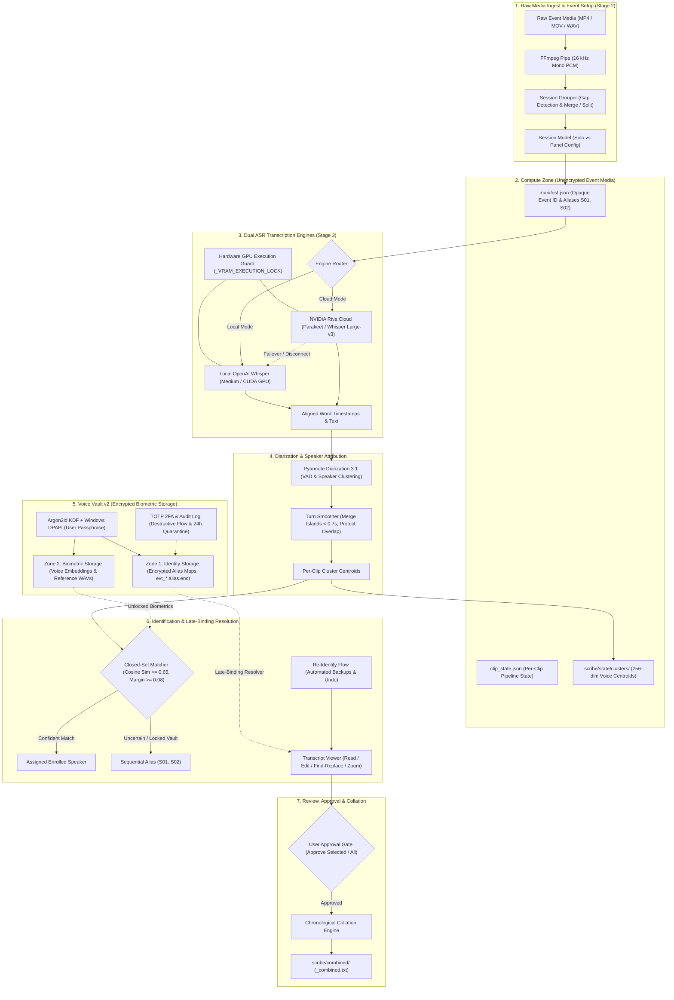
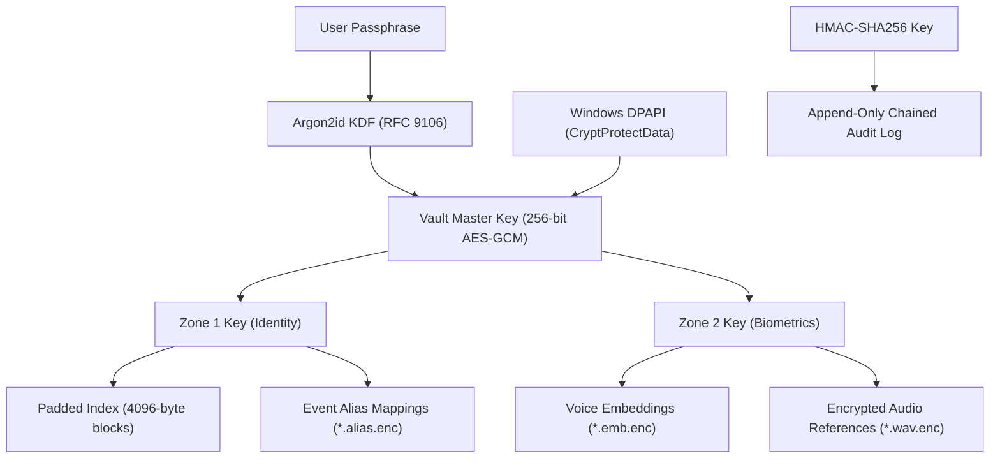

# Session Scribe — System Architecture & Data Flow

This document details the software architecture, component boundaries, cryptographic isolation zones, and data flow of **Session Scribe**.

---

## 1. High-Level Architecture Diagram

---

## 2. Core Architectural Principles

### A. Privacy-First Compute Zone Isolation
* **Zero Names on Event Media Disks:** Compute-zone files (`manifest.json`, `clip_state.json`) store only sequential aliases (`S01`, `S02`, ...) and an opaque `event_id` (`evt_<16 hex chars>`).
* **Vault-Encrypted Identity Maps:** True speaker names and biometric profile identifiers (`spk_...`) are stored exclusively inside Vault v2 Zone 1 (`%LOCALAPPDATA%\SessionScribe\vault\v2\alias_maps\<event_id>.alias.enc`), encrypted under the user's master key.
* **Order-of-Appearance Elimination:** Unmatched speech turns are never attributed to roster speakers by accidental file order or clip sequence. Unidentified turns remain explicitly tagged as `[Unidentified]`.

### B. Hardware & Resource Isolation
* **VRAM Execution Lock (`_VRAM_EXECUTION_LOCK`):** Local Whisper speech recognition and Pyannote neural diarization alternate GPU execution sequentially. They never allocate CUDA memory concurrently, ensuring smooth execution within 4 GB to 8 GB consumer GPU VRAM limits.
* **In-Memory Audio Processing:** Audio chunks extracted for voice enrollment and snippet listening stream directly through memory pipes via FFmpeg. Raw unencrypted reference audio never touches persistent disk storage.

### C. Decoupled Workflow & Optional Vault
* **Non-Blocking Operation:** Stage 2 media ingest, Stage 3 ASR transcription, manual transcript editing, user approval gates, and file collation operate seamlessly whether the Voice Vault is locked, unlocked, or has never been initialized.
* **Late-Binding Name Resolution:** Decrypted speaker names are resolved dynamically in memory only when viewing transcripts with an unlocked vault or generating final combined text files.
* **Persistent Voice Centroids:** Diarization outputs 256-dimensional unit acoustic centroids stored in `scribe/state/clusters/<clip>.json`. This enables in-place Re-Identification across app restarts whenever the vault is unlocked later.

### D. Dual Transcription & Automatic Failover
* **Local Engine:** Local OpenAI Whisper Medium running via PyTorch CUDA. Completely offline with zero external bandwidth.
* **Cloud Engine:** Ephemeral streaming transcription via NVIDIA Riva gRPC (Parakeet TDT / Whisper Large-v3) achieving 10× to 15× real-time speeds with automatic transparent failover to local Whisper on network interruptions.
* **Midpoint Checkpoint Resume:** Session state checkpoints every 30 seconds allow interrupted jobs to resume from the last boundary without restarting the clip.

---

## 3. Cryptographic Hierarchy (Voice Vault v2)

* **Zone 1 (Identity):** Profile metadata, display names, roles, consent timestamps, and per-event alias mappings.
* **Zone 2 (Biometrics):** 256-dimensional PyAnnote voice embeddings and AES-256-GCM encrypted audio snippets.
* **Audit Trail:** Monotonic sequence counter and HMAC-SHA256 signature chain with external head mirror.
