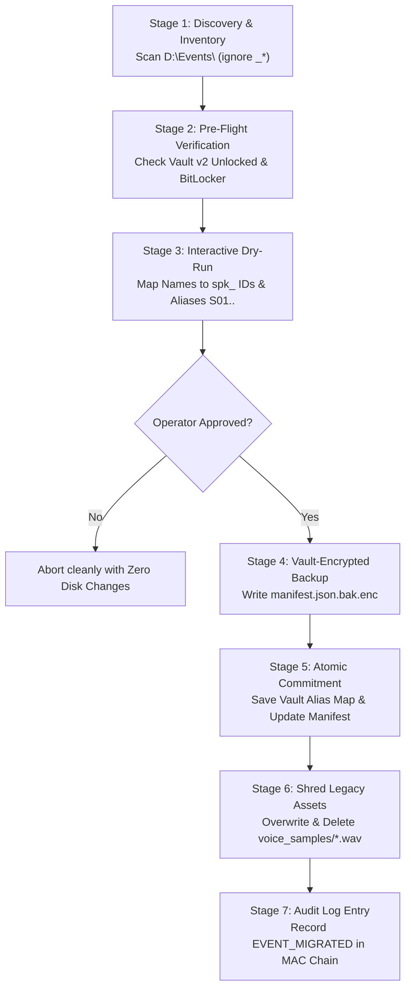

# Session Scribe — Event Migration Design Document
**Document Version:** 1.0.0  
**Status:** Approved Design (Non-Implemented / Blueprint Specification)  
**Security Level:** Confidential — Architecture & Cryptographic Specification  
**Governing Standard:** AGENTS.md, docs/security/threat_model.md, docs/security/vault_format.md  

---

## 1. Executive Summary & Migration Objective

Session Scribe is transitioning from legacy flat-file storage to the **Vault v2 Dual-Zone Cryptographic Architecture**.

### 1.1 The Legacy Security Defect
In legacy versions of Session Scribe:
1. `D:\Events\<event>\scribe\manifest.json` stored plaintext personal identities (e.g. real speaker names, organizer details) directly in the compute zone.
2. `D:\Events\<event>\scribe\state\clip_state.json` tracked clip transcription state while embedding real personal names in candidate tags.
3. `D:\Events\<event>\scribe\voice_samples\*.wav` stored unencrypted 16 kHz WAV reference clips in cleartext on disk.
4. `D:\Events\_voice_library\*.npy` stored unencrypted 256-dimensional neural voice embeddings.

This violated the core security invariant: **Compute-zone files must never contain biometric material or personal identities, which creates disk leakage accessible to malware, local LLM coding assistants, or unauthorized users.**

### 1.2 Target Architecture (Vault v2 Specification)
Under Vault v2:
- **Zero Plaintext in Compute Zone:** `manifest.json` and `clip_state.json` carry random event identifiers (`evt_...`) and per-event anonymous aliases (`S01`, `S02`, ...) only.
- **One Person = One Persistent ID:** Each human speaker has exactly one random 128-bit identifier (`spk_<16 hex chars>`) across all sessions and events.
- **Cryptographic Separation:**
  - Real names, consent records, and per-event alias maps live exclusively in **Zone 1 (Identity)**, encrypted with AES-256-GCM under the Identity Zone Key.
  - Neural voice embeddings and reference WAV samples live exclusively in **Zone 2 (Biometrics)**, encrypted with AES-256-GCM under the Biometric Zone Key.
- **Dry-Run & Encrypted Backup:** The migration tool must execute in read-only dry-run mode first, verify all invariants, create a vault-encrypted backup of original files, and commit changes atomically.

---

## 2. Threat Model & Migration Security Invariants

| Threat / Risk | Mitigation in Migration Workflow |
| :--- | :--- |
| **Plaintext Leak via Backup** | Backups of `manifest.json` are encrypted with AES-256-GCM under the Vault Master Key (`manifest.json.bak.enc`). No unencrypted `.bak` files are ever written to disk. |
| **Incomplete Migration State** | All manifest updates use atomic write-and-rename (`atomic_write_bytes`). If interrupted, the file remains in its previous valid state. |
| **Duplicate Identity Fragmentation** | Names matching existing Vault v2 profiles are mapped to their existing `spk_` ID. New profiles are enrolled through the verified V4 enrollment pipeline. |
| **Quarantined Profile Infiltration** | Quarantined profiles are strictly filtered out; they cannot be assigned aliases or included in migrated event rosters. |
| **SSD / Wear-Leveling Remanence** | Legacy cleartext WAVs are overwritten with zeros, deleted, and operator is advised to run BitLocker or cipher free-space wipe. |

---

## 3. Seven-Stage Migration Process



### Stage 1: Discovery & Inventory
The migration CLI (`scripts/migrate_events_to_vault_v2.py`) scans `D:\Events\*`:
1. **Directory Filter:** Any directory starting with an underscore (`_`), such as `_voice_library`, `_usage`, or `_archive`, is strictly ignored.
2. **File Inventory:** For each detected event directory, inspect:
   - `<event_root>\scribe\manifest.json`
   - `<event_root>\scribe\state\clip_state.json`
   - `<event_root>\scribe\voice_samples\`
3. **Parse Manifest Version:** Check if `"event_id"` already exists in `manifest.json`. If present and aliases are already deployed, skip as already migrated.

### Stage 2: Pre-Flight Verification
Before processing any data:
1. Verify Vault v2 is initialized and unlocked with the operator's passphrase.
2. Confirm the Identity Zone Key and Biometric Zone Key are active in memory.
3. Check volume BitLocker protection status via Windows WMI:
   `manage-bde -status D:` (warns if volume encryption is inactive).
4. Assert at least 500 MB free space on target volume for temporary encrypted staging.

### Stage 3: Interactive Dry-Run Mode (`--dry-run`)
Dry-run mode is read-only and produces a comprehensive audit report:
1. **Extract Plaintext Names:** Collect all unique speaker names from `manifest.json` sessions and `clip_state.json`.
2. **Reconciliation against Vault v2:**
   - **Case A (Enrolled):** Name matches an existing Zone 1 Identity profile. Link to persistent `spk_<hex>` ID.
   - **Case B (Un-enrolled):** Name has legacy audio in `scribe\voice_samples\<name>.wav`. The operator is prompted to run V4 quality verification (minimum 10s speech, SNR $\ge 12$ dB, single speaker) and enroll into Vault v2.
   - **Case C (Unmapped / Anonymous):** Named `Unnamed N` or missing. Assigned anonymous placeholder alias without biometric binding.
3. **Generate Event Identifier & Aliases:**
   - Generate `event_id`: `evt_<16 hex chars>` (e.g. `evt_6f4b2a89c1d3e5f7`).
   - Assign per-event aliases sequentially: `S01`, `S02`, `S03`, ...
4. **Display Dry-Run Report:**
   ```
   ======================================================================
   SESSION SCRIBE EVENT MIGRATION REPORT (DRY RUN)
   Event: AI Summit 2026 (D:\Events\2026-09-05_AI_Summit)
   Generated Event ID: evt_6f4b2a89c1d3e5f7
   ----------------------------------------------------------------------
   Roster Reconciliation:
     • "Dr. Katherine Synthetic" ➔ Alias: S01 ➔ Vault ID: spk_7a8b9c... [Enrolled]
     • "Prof. Alan Turing"       ➔ Alias: S02 ➔ Vault ID: spk_4d5e6f... [Enrolled]
     • "Elena Rostova"           ➔ Alias: S03 ➔ Vault ID: spk_1a2b3c... [New Enrollment]
   
   Compute-Zone Manifest Transformations:
     • Session 1: Solo "Dr. Katherine Synthetic" ➔ Solo (Expected Speaker: S01)
     • Session 2: Panel "Panel Discussion"       ➔ Panel (Host: S01, Panelists: S02, S03)
     • Total clips to re-tag: 18
     • Total legacy WAVs to shred: 3 (45.2 MB)
   ======================================================================
   Dry run completed. Zero files modified on disk.
   ```

### Stage 4: Vault-Encrypted Atomic Backup
Prior to modifying any file:
1. Read existing `manifest.json` into memory.
2. Derive a per-event backup key using HKDF-SHA256 from the Vault Master Key:
   $$\text{BackupKey} = \text{HKDF}(\text{MasterKey}, \text{salt}=\text{event\_id}, \text{info}=\text{"event\_backup\_v1"})$$
3. Encrypt `manifest.json` with AES-256-GCM (random 96-bit nonce, record ID bound in AAD).
4. Atomically write ciphertext to `D:\Events\<event>\scribe\manifest.json.bak.enc`.
5. **No plaintext `.bak` file is EVER created.**

### Stage 5: Atomic Commitment
1. **Save Encrypted Alias Map in Vault v2:**
   - Save `{ "S01": "spk_7a8b9c...", "S02": "spk_4d5e6f...", ... }` to Vault v2 Identity Zone under:
     `%USERPROFILE%\.session_scribe_vault\zone_identity\alias_maps\<event_id>.alias.enc`
2. **Rewrite `manifest.json`:**
   - Embed `"event_id": "<event_id>"` in `"event"` object.
   - Update each session in `"sessions"`:
     - Replace plaintext `speaker` with alias or `Panel Session N`.
     - Set `session_type`: `"solo"` or `"panel"`.
     - For Solo: embed `"expected_speaker": {"alias": "S01", "role": "Speaker"}`.
     - For Panel: embed `"host": {"alias": "S01", "role": "Host"}` and `"panelists": [{"alias": "S02", "role": "Panelist"}, ...]`.
     - Strip all real personal names and `spk_` IDs.
   - Atomically overwrite `manifest.json` via temporary file and atomic swap.
3. **Rewrite `clip_state.json`:**
   - Replace any candidate tags matching real names with their corresponding aliases (`S01`, `S02`).

### Stage 6: Best-Effort Crypto-Shredding of Legacy Assets
1. For each legacy file in `D:\Events\<event>\scribe\voice_samples\*.wav`:
   - Overwrite file contents with cryptographic pseudorandom bytes.
   - Flush and sync to storage via `os.fsync()`.
   - Overwrite file contents with zeros.
   - Flush and sync to storage via `os.fsync()`.
   - Delete file via `os.remove()`.
2. Delete the directory `D:\Events\<event>\scribe\voice_samples\`.
3. If `D:\Events\_voice_library\` contains plaintext `.npy` files for the migrated profiles:
   - Best-effort overwrite with zeros and delete.

### Stage 7: Keyed-MAC Audit Log Entry
Record the migration event in the Vault v2 Keyed-MAC audit log:
- **Action:** `EVENT_MIGRATED`
- **Target ID:** `<event_id>`
- **Details:**
  - `event_name_hash`: SHA-256 of the event name.
  - `session_count`: Total sessions migrated.
  - `alias_count`: Total aliases assigned.
  - `backup_path`: `scribe/manifest.json.bak.enc`
  - `timestamp`: UTC ISO 8601 string.
- Update the external head hash mirror to guarantee append-only immutability.

---

## 4. Rollback & Disaster Recovery Specification

If an operator aborts the migration or an unhandled I/O error occurs:
1. Check for the existence of `scribe/manifest.json.bak.enc`.
2. Authenticate and decrypt `manifest.json.bak.enc` using the derived `BackupKey`.
3. Atomically overwrite `scribe/manifest.json` with the restored plaintext content.
4. Remove the per-event alias map `zone_identity/alias_maps/<event_id>.alias.enc` from Vault v2.
5. Record `EVENT_MIGRATION_ROLLED_BACK` in the Keyed-MAC audit log.

---

## 5. Security & Invariant Checklist

| Invariant Verification Rule | Test / Gate Check |
| :--- | :--- |
| **Zero Plaintext Canary Scan** | Canary search for real speaker names across `manifest.json`, `clip_state.json`, and all compute-zone files must yield 0 matches. |
| **Zero Persistent spk_ IDs in Manifest** | RegEx scan `spk_[0-9a-f]{16}` across `manifest.json` must yield 0 matches. |
| **One Person = One spk_ ID** | Two different aliases across two events resolving to the same person must map to the exact same `spk_` ID in Vault v2. |
| **Quarantine Isolation** | Quarantined profiles cannot be mapped to aliases during migration. |
| **No Unencrypted Backups** | Verify that no `.bak`, `.old`, or `.tmp` files containing plaintext exist on disk. |
